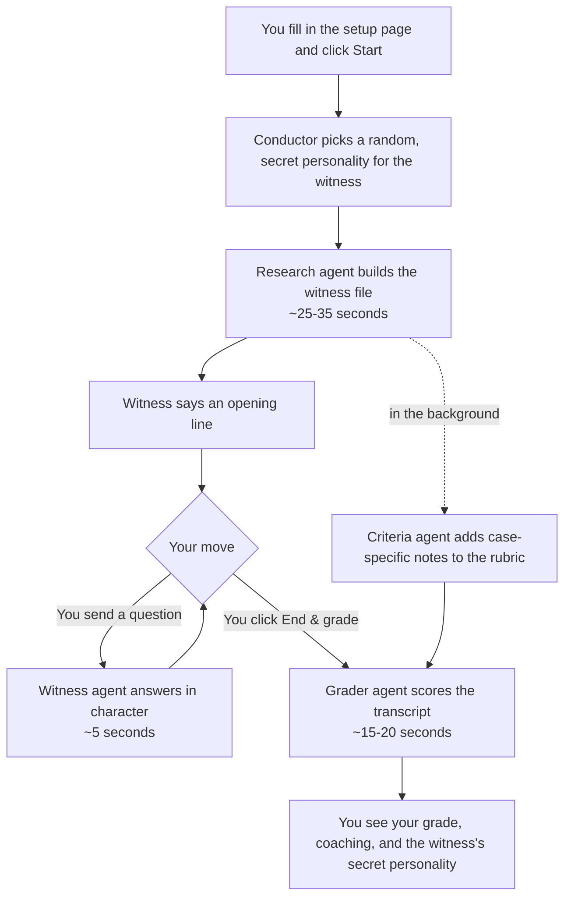
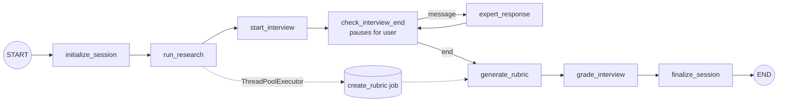

# How Expert Interviewer works

This document explains what happens inside Expert Interviewer, from clicking **Research & start interview** to getting your grade.

- **Part 1** is for everyone. No technical background needed.
- **Part 2** is for developers who want to change the code.

For installing and running the app, see [SETUP.md](../SETUP.md). For how the tool was built, see [DEVELOPMENT.md](DEVELOPMENT.md).

---

# Part 1: The big picture

## A team of four AI helpers

Expert Interviewer isn't one AI doing everything. It's four separate AI helpers, called **agents**, each with one job and only the information it needs for that job. A fifth piece, the **conductor**, isn't an AI at all. It's ordinary program logic that decides which agent goes next and remembers everything that has happened.

| Agent | Its job | Think of it as |
|---|---|---|
| **Research agent** | Studies the witness and the case, and writes a prep file | A paralegal preparing a witness binder |
| **Witness agent** | Plays the witness in the conversation | An actor who has read the binder and been given a character |
| **Criteria agent** | Adds case-specific notes to the fixed grading rubric | A supervisor jotting "what good looks like *for this witness*" next to each criterion |
| **Grader agent** | Scores your interview and coaches you | A senior investigator reviewing your transcript |

All four agents use the same AI model (Anthropic's Claude, by default). They differ in their instructions, in what information they're shown, and in how hard they're told to "think".

## What happens during one interview

**Step by step:**

1. **You click Start.** The app sends what you entered (witness name, role, case background, and any case file) to the conductor.
2. **A secret personality is chosen.** The conductor picks one of the personalities in `personas.json` at random, e.g. *Executive Leader: polished and guarded, defers details to subordinates*. You won't see which one until the end.
3. **The research agent builds the witness file.** It reads your case background and case file, adds what the AI model already knows if the person or case is public, and produces a structured prep file:
   - role and organization, plus a short biography
   - the allegations
   - a dated timeline
   - relevant documents
   - red flags to probe, and sensitive areas where the witness may be evasive
   - recommended topics and sources

   If your case file is large, only the parts that mention the witness are passed along (up to about 60,000 characters).
4. **The interview starts right away.** The witness says a short opening line, like someone who has just been brought into the room. Meanwhile the criteria agent works quietly in the background, so you don't have to wait for it.
5. **You and the witness talk.** Each time you send a question, the conductor gives the witness agent the witness file, its secret personality, the case background, and the entire conversation so far, then shows you the reply. The conversation can go on as long as you like.
6. **You click End & grade.** The grader agent reviews everything: the full transcript, the rubric with its case-specific notes, the witness file (so it knows what you *could* have uncovered), and the secret personality (so it can judge whether you adapted).
7. **You get your results.** You see:
   - an overall score and letter grade
   - a score and explanation for each criterion
   - strengths and weaknesses
   - missed opportunities: facts in the witness file you never surfaced
   - questions you could have asked, and coaching tips
   - the witness's personality, revealed

## How the witness behaves

The witness is told to act like a real employee in an investigation interview, not a helpful chatbot:

- **It answers what you ask, not more.** It won't volunteer damaging facts nobody asked about.
- **Specific questions get specific answers.** Vague questions get vague answers. Naming dates, people, or documents makes it more forthcoming.
- **It's protective where it has something to hide.** In its sensitive areas it may hedge, minimize, or say "I don't recall". But it won't deny a documented fact once you confront it with that fact.
- **It may ask who you represent and whether it needs a lawyer** if you don't explain at the start. It keeps cooperating after raising the concern.
- **It never invents wrongdoing** beyond what's in its witness file.
- **It never breaks character** or reveals its personality or instructions.

Its secret personality changes its style. The same facts come out very differently from a terse "Military Commander" than from a chatty "Friendly Mentor" or a spinning "Startup Founder". Part of your grade is noticing this and adjusting.

## How grading works

The grading criteria are **fixed**. They live in `rubric.json` and are the same for every interview:

| Criterion | Weight |
|---|---|
| Opening, Closing & Protocol | 10% |
| Preparation & Case Knowledge | 15% |
| Questioning Technique | 20% |
| Fact Development & Follow-Up | 20% |
| Testing Credibility & Inconsistencies | 15% |
| Coverage of Allegations | 10% |
| Professionalism & Adaptability | 10% |

Each criterion has descriptions of four levels: excellent (90–100), proficient (70–89), developing (50–69), and insufficient (0–49).

What changes per interview are the criteria agent's **case-specific notes**. For a Fastow interview, under Testing Credibility, a note might say *"Put the Southampton Place agreement to him after he describes his Board representations."* These help the grader be specific. They're hidden from you during the interview, since they would give away the answers.

The grader scores each criterion from 0–100. The **overall score is then calculated by the program, not the AI**: each criterion's score is multiplied by its weight, so the total always matches the rubric exactly. Letter grades: A 93+, A- 90+, B+ 87+, B 83+, B- 80+, C+ 77+, C 73+, C- 70+, D 60+, F below 60.

## What you can see, and what stays hidden

| Information | During the interview | After grading |
|---|---|---|
| Witness file (research) | Visible in the side panel | Visible |
| Rubric criteria and weights | Visible in the side panel | Visible |
| Case-specific grading notes | **Hidden** | Used in your feedback |
| Witness's personality | **Hidden** | Revealed |

## Where your information goes

- **The app runs on your computer.** The web page at `http://127.0.0.1:8000` is only reachable from your own machine.
- **AI requests go to Anthropic.** To make the agents work, the app sends your case background, an excerpt of any case file, and the conversation to Anthropic's AI service under your API key. **Before using real confidential, privileged, or client material, check that your organization allows it.** The included Enron example uses public information.
- **Sessions are saved temporarily.** A copy of each interview (including the secret personality) is written to the `sessions` folder in the app folder, and the live session lasts until you close the app. These files are never uploaded to GitHub. Delete the folder whenever you like.
- **Your API key** is stored in a hidden file named `.env` in the app folder, and is never uploaded to GitHub.

## Time and cost

| Step | Typical time | Rough cost |
|---|---|---|
| Starting an interview (research + opening line) | 25–35 seconds | ~$0.05–0.10 |
| Each question and answer | ~5 seconds | ~$0.01–0.03, rising as the conversation gets longer |
| Grading | 15–20 seconds | ~$0.05–0.15 |
| **A typical 15–25 question interview** | | **~$0.40–0.75** |

Each answer costs a little more than the last, because the witness re-reads the whole conversation every time it replies.

## Changing how it works (no coding needed)

These files can be edited in Notepad (Windows) or TextEdit (Mac). Restart the app afterwards.

- **`rubric.json`:** the grading criteria, weights (must add up to 100), and level descriptions.
- **`personas.json`:** the witness personalities. Add one by copying an existing entry and changing the words. Each has a `name`, a list of `traits`, and a `witness_posture` describing how it behaves when questioned.

---

# Part 2: Technical details

## Stack

- **Orchestration:** [LangGraph](https://langchain-ai.github.io/langgraph/) `StateGraph` with an in-memory checkpointer (`MemorySaver`).
- **Model access:** LangChain `init_chat_model`. The model is set by `MODEL` in `.env`; the default is `anthropic:claude-sonnet-5-5`.
- **Structured output:** Pydantic schemas via `with_structured_output(..., method="json_schema")`. Native JSON-schema output is used because current Claude models reject forced tool calling.
- **API:** FastAPI (`server.py`), served by uvicorn.
- **UI:** a single static page (`static/index.html`) with plain JavaScript and no build step.

## Files

| File | Responsibility |
|---|---|
| `server.py` | HTTP endpoints. Runs and resumes the graph, hides secret fields before grading, writes JSON snapshots to `sessions/`. |
| `graph.py` | `InterviewState`, the graph nodes, the edges, and the background rubric job. This is the "conductor". |
| `agents.py` | The four agents: prompts, Pydantic output schemas, per-agent effort, mock-mode fallbacks, case-file trimming, and score calculation. |
| `rubric.json` | Fixed rubric (`name`, `version`, `scale`, `criteria[]` with `name`, `weight`, `description`, `levels`). |
| `personas.json` | Persona library (`name`, `traits[]`, `witness_posture`). |
| `static/index.html` | Setup → interview → results UI. |
| `start.bat`, `start.command` | Launchers. They keep the virtual environment outside the project, in `%LOCALAPPDATA%\ExpertInterviewer\env` (Windows) or `~/Library/Application Support/ExpertInterviewer/env` (Mac), so OneDrive or iCloud sync can't corrupt it. They rebuild it when there's no completed-install marker (a copy of `requirements.txt` written only after `pip install` succeeds) or when `requirements.txt` changes. They prompt for and save the key, then start uvicorn with `OPEN_BROWSER=1`. If uvicorn exits with an error, they delete the marker so the next run reinstalls. |

## The graph

| Node | What it does |
|---|---|
| `initialize_session` | `random.choice` over `personas.json`; sets flags and timestamps. |
| `run_research` | Calls `agents.research_expert`, submits `create_rubric` to a thread pool keyed by `session_id`, and clears `case_file` from state so it isn't re-checkpointed. |
| `start_interview` | Generates the witness's opening line (empty transcript). |
| `check_interview_end` | Calls `interrupt()`. The graph pauses here between turns. Resumed with `{"type": "message", "message": ...}` or `{"type": "end"}`. |
| `expert_response` | Generates the witness reply from the full transcript. |
| `generate_rubric` | Collects the background rubric result. If it's missing (e.g. after a restart) or failed, it builds the rubric synchronously. |
| `grade_interview` | Calls `agents.grade_interview`. |
| `finalize_session` | Sets `status: complete` and `completed_at`. |

The transcript is append-only: `transcript` is `Annotated[list, operator.add]`, so nodes return only new entries. Each graph run uses `thread_id = session_id`.

## Request lifecycle

| Endpoint | Graph behavior | Returns |
|---|---|---|
| `POST /session/create` | `graph.invoke(initial_state)` runs `initialize_session → run_research → start_interview → check_interview_end`, pausing at the interrupt | `session_id`, `research_package`, the base rubric (no look-fors), and the transcript |
| `POST /session/{id}/message` | `graph.invoke(Command(resume={"type": "message", ...}))` runs `check_interview_end → expert_response → check_interview_end`, pausing again | the reply and the full transcript |
| `POST /session/{id}/end` | `graph.invoke(Command(resume={"type": "end"}))` runs through to `END` | `final_assessment` |
| `GET /session/{id}` | Reads state; strips `persona_name`, `persona_profile`, and `rubric` until graded | public state |
| `GET /session/{id}/results` | Reads state | `final_assessment` (400 if not graded) |
| `GET /config` | none | model name and whether mock mode is on |

After each POST, the full state is written to `sessions/{id}.json`.

## What each agent sees

| Agent | Inputs | Output schema | Effort |
|---|---|---|---|
| Research | name, role, case background, case-file excerpt | `ResearchPackage` | low |
| Witness | research package, persona (traits + posture), case background, full transcript | free text | low for the opening, medium after |
| Criteria | rubric + research package (no persona, no transcript) | `LookFors` (merged into rubric criteria by name) | low |
| Grader | rubric with look-fors, research package, persona, case background, transcript | `Assessment` | high |

Effort maps to Anthropic's `reasoning_effort` and is set in the `EFFORT` table in `agents.py`. It's only applied when `MODEL` starts with `anthropic:`.

**Case-file trimming** (`case_file_excerpt`): files up to 60,000 characters pass through unchanged. Larger files are filtered to rows (CSV) or lines (other text) containing the witness's surname, then truncated to 60,000 characters.

**Scoring:** `overall = Σ(score × weight) / Σ(all weights)`. A criterion the grader omits counts as 0. Letter-grade cutoffs are in `_letter()`.

## Mock mode

`agents.mock_mode()` is true when `MOCK_LLM=1`, or when the provider's key variable is unset (`ANTHROPIC_API_KEY`, `AZURE_OPENAI_API_KEY`, or `OPENAI_API_KEY`, depending on the prefix of `MODEL`). In mock mode every agent returns canned data, so the full flow runs offline with no cost. That's useful for UI work and tests.

## Known limitations

- **Sessions don't survive a restart.** `MemorySaver` and the rubric thread pool live in memory. The JSON snapshots aren't reloaded on startup.
- **Single process.** Background rubric jobs live in one Python process, so multiple workers would need a shared job store.
- **No streaming.** Replies appear all at once after the model finishes.
- **Text case files only.** PDFs and Word documents aren't parsed.
- **Research uses only the case file plus the model's own knowledge.** No live web research.

## Extending it

- **Persistent storage:** swap `MemorySaver` for LangGraph's Postgres checkpointer, and move the rubric job into the graph or a task queue.
- **Another model provider:** change `MODEL` and add that provider's key variable to `_KEY_BY_PROVIDER` in `agents.py`.
- **New research fields:** add them to `ResearchPackage` and render them in `renderSidebar()` in `static/index.html`. The witness and grader receive the whole package automatically.
