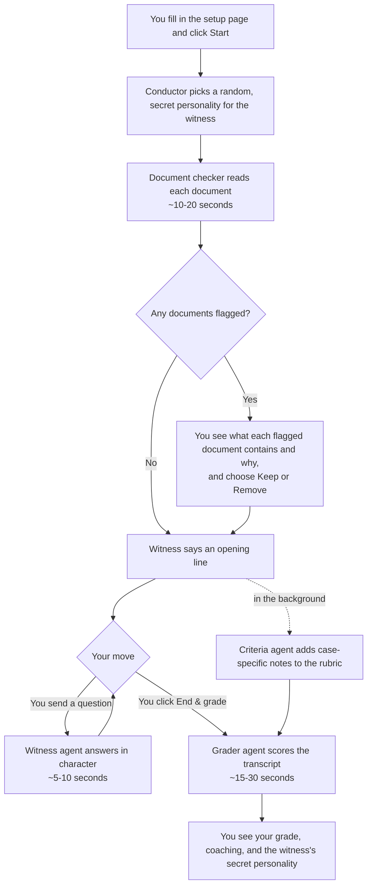
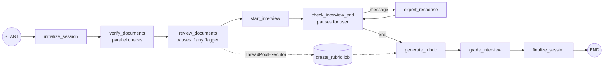

# How Expert Interviewer works

This document explains what happens inside Expert Interviewer, from clicking **Check documents & start interview** to getting your grade.

- **Part 1** is for everyone. No technical background needed.
- **Part 2** is for developers who want to change the code.

For installing and running the app, see [SETUP.md](../SETUP.md). For how the tool was built, see [DEVELOPMENT.md](DEVELOPMENT.md).

---

# Part 1: The big picture

## A team of four AI helpers

Expert Interviewer isn't one AI doing everything. It's four separate AI helpers, called **agents**, each with one job and only the information it needs for that job. A fifth piece, the **conductor**, isn't an AI at all. It's ordinary program logic that decides which agent goes next and remembers everything that has happened.

| Agent | Its job | Think of it as |
|---|---|---|
| **Document checker** | Reads each uploaded document and flags any that look like they were added by mistake | A paralegal checking the binder before it goes to the interviewer |
| **Witness agent** | Plays the witness in the conversation | An actor who has read the case file and been given a character |
| **Criteria agent** | Adds case-specific notes to the fixed grading rubric | A supervisor jotting "what good looks like *for this witness*" next to each criterion |
| **Grader agent** | Scores your interview and coaches you | A senior investigator reviewing your transcript |

All four agents use the same AI model (Anthropic's Claude, by default). They differ in their instructions, in what information they're shown, and in how hard they're told to "think".

**Everything the agents know about the case comes from you:** the case background you type and the documents you keep. The app doesn't add facts from the internet or from the AI's general knowledge.

## What happens during one interview

**Step by step:**

1. **You click Start.** The app sends what you entered (witness name, role, case background, and your documents) to the conductor. PDF and Word files are turned into plain text first.
2. **A secret personality is chosen.** The conductor picks one of the personalities in `personas.json` at random, e.g. *Executive Leader: polished and guarded, defers details to subordinates*. You won't see which one until the end.
3. **The document checker reviews each document.** It compares each one with your case background and the witness, all at the same time, and decides whether it belongs. It flags documents that look like mistakes:
   - **Addressed to someone else:** an email, letter, or memo that doesn't involve the witness and isn't about the case, such as an email meant for a different person.
   - **Unrelated to this case:** about a different company, person, or matter.
   - **May not belong here:** anything else out of place, such as personal files, spam, a template, or a file with no readable text (for example a scanned PDF).

   Documents about the case are kept even if they were written by or to other people.
4. **You decide about flagged documents.** If anything was flagged, the app stops and shows each flagged document:
   - what it contains, in a sentence or two
   - why it was flagged
   - its opening text

   You choose **Keep it** or **Remove it** for each one. Documents that passed are listed too. If nothing was flagged, this screen is skipped.
5. **The interview starts.** The kept documents are combined into the case file the witness, criteria, and grader agents read. If they're very long, only the parts that mention the witness are used (about 60,000 characters in all, roughly 30 pages). The witness says a short opening line, like someone who has just been brought into the room. Meanwhile the criteria agent works quietly in the background.
6. **You and the witness talk.** Each time you send a question, the witness agent gets the case background, the documents, its secret personality, and the entire conversation so far. The conversation can go on as long as you like.
7. **You click End & grade.** The grader agent reviews the full transcript, the rubric with its case-specific notes, the documents (so it knows what you *could* have uncovered), and the secret personality (so it can judge whether you adapted).
8. **You get your results:**
   - an overall score and letter grade
   - a score and explanation for each criterion
   - strengths and weaknesses
   - missed opportunities: facts in the documents you never surfaced
   - questions you could have asked, and coaching tips
   - the witness's personality, revealed

## How the witness behaves

The witness is told to act like a real employee in an investigation interview, not a helpful chatbot:

- **It knows only the case background and the kept documents**, treating them as the facts of its world. Asked about something they don't cover, it says it wasn't involved or doesn't recall.
- **It answers what you ask, not more.** It won't volunteer damaging facts nobody asked about.
- **Specific questions get specific answers.** Vague questions get vague answers. Naming dates, people, or documents makes it more forthcoming.
- **It's protective where the documents point at it.** Anything suggesting it personally did something wrong is sensitive. There it may hedge, minimize, or say "I don't recall". But it won't deny a documented fact once you confront it with that fact.
- **It may ask who you represent and whether it needs a lawyer** if you don't explain at the start. It keeps cooperating after raising the concern.
- **It never invents wrongdoing** the documents don't support.
- **It never breaks character** or reveals its personality or instructions.

Its secret personality changes its style. The same facts come out very differently from a terse "Military Commander" than from a chatty "Friendly Mentor" or a spinning "Startup Founder". Part of your grade is noticing this and adjusting.

## How grading works

See [ASSESSMENT.md](ASSESSMENT.md) for a one-page summary. In short: the grading criteria are **fixed** (they live in `rubric.json`), the criteria agent adds hidden case-specific notes, the AI scores each criterion from 0 to 100, and **the program, not the AI, calculates the weighted overall score and letter grade.**

## What you can see, and what stays hidden

| Information | During the interview | After grading |
|---|---|---|
| Your kept documents (name and a short summary) | Visible in the side panel | Visible |
| Rubric criteria and weights | Visible in the side panel | Visible |
| Case-specific grading notes | **Hidden** | Used in your feedback |
| Witness's personality | **Hidden** | Revealed |

## Where your information goes

- **The app runs on your computer.** The web page at `http://127.0.0.1:8000` is only reachable from your own machine.
- **AI requests go to Anthropic.** To make the agents work, the app sends your case background, your documents (the opening of each one for the check, then the kept ones), and the conversation to Anthropic's AI service under your API key. **Before using real confidential, privileged, or client material, check that your organization allows it.** The included Enron example uses public information.
- **Sessions are saved temporarily.** A copy of each interview, including the text of your documents and the secret personality, is written to the `sessions` folder in the app folder. The live session lasts until you close the app. These files are never uploaded to GitHub. Delete the folder whenever you like.
- **Your API key** is stored in a hidden file named `.env` in the app folder, and is never uploaded to GitHub.

## Time and cost

| Step | Typical time | Rough cost |
|---|---|---|
| Checking documents | 10–20 seconds | ~$0.01 per document |
| Starting the interview (opening line) | ~5 seconds | ~$0.02–0.05 |
| Each question and answer | 5–10 seconds | ~$0.01–0.03, rising as the conversation gets longer |
| Grading | 15–30 seconds | ~$0.05–0.20 |
| **A typical 15–25 question interview** | | **~$0.40–0.80** |

The documents are cached between questions, so after the first answer they cost about a tenth of the normal price to re-read. Each answer still costs a little more than the last, because the witness re-reads the whole conversation every time it replies.

## Changing how it works (no coding needed)

These files can be edited in Notepad (Windows) or TextEdit (Mac). Restart the app afterwards.

- **`rubric.json`:** the grading criteria, weights (must add up to 100), and level descriptions.
- **`personas.json`:** the witness personalities. Add one by copying an existing entry and changing the words. Each has a `name`, a list of `traits`, and a `witness_posture` describing how it behaves when questioned.

---

# Part 2: Technical details

## Stack

- **Orchestration:** [LangGraph](https://langchain-ai.github.io/langgraph/) `StateGraph` with an in-memory checkpointer (`MemorySaver`).
- **Model access:** LangChain `init_chat_model`. The model is set by `MODEL` in `.env` (default `anthropic:claude-sonnet-5-5`), with optional per-agent overrides `MODEL_WITNESS`, `MODEL_CHECKER`, `MODEL_CRITERIA`, and `MODEL_GRADER`. See [MODELS.md](MODELS.md).
- **Structured output:** Pydantic schemas via `with_structured_output(..., method="json_schema")`. Native JSON-schema output is used because current Claude models reject forced tool calling.
- **API:** FastAPI (`server.py`), served by uvicorn.
- **UI:** a single static page (`static/index.html`) with plain JavaScript and no build step.
- **Document text:** `pypdf` for PDFs, the standard library for .docx (`word/document.xml`) and text types.

## Files

| File | Responsibility |
|---|---|
| `server.py` | HTTP endpoints. Decodes uploads, extracts text, runs and resumes the graph, hides secret fields and document text from responses, writes JSON snapshots to `sessions/`. |
| `graph.py` | `InterviewState`, the graph nodes, the edges, the parallel document checks, and the background rubric job. This is the "conductor". |
| `agents.py` | The four agents: prompts, Pydantic output schemas, per-agent effort, prompt caching, mock-mode fallbacks, and score calculation. |
| `documents.py` | Text extraction (`extract_text`) and combining kept documents into the agents' case file (`build_context`, `witness_excerpt`). |
| `rubric.json` | Fixed rubric (`name`, `version`, `scale`, `criteria[]` with `name`, `weight`, `description`, `levels`). |
| `personas.json` | Persona library (`name`, `traits[]`, `witness_posture`). |
| `static/index.html` | Setup → document review → interview → results UI. |
| `start.bat`, `start.command` | Launchers. They keep the virtual environment outside the project, in `%LOCALAPPDATA%\ExpertInterviewer\env` (Windows) or `~/Library/Application Support/ExpertInterviewer/env` (Mac), so OneDrive or iCloud sync can't corrupt it. They rebuild it when there's no completed-install marker (a copy of `requirements.txt` written only after `pip install` succeeds) or when `requirements.txt` changes. They prompt for and save the key, then start uvicorn with `OPEN_BROWSER=1`. If uvicorn exits with an error, they delete the marker so the next run reinstalls. |

## The graph

| Node | What it does |
|---|---|
| `initialize_session` | `random.choice` over `personas.json`; sets flags and timestamps. |
| `verify_documents` | Runs `agents.check_document` on every document in a thread pool and stores each result as `doc["check"]` (`relevant`, `category`, `summary`, `reason`). Documents with no extractable text are flagged without a model call. |
| `review_documents` | If any document is flagged, calls `interrupt()` and resumes with `{doc_id: keep_bool}`. Flagged documents not explicitly kept are dropped. Builds `document_context` from the kept documents with `documents.build_context` and submits `create_rubric` to the thread pool. Passes straight through when nothing is flagged. |
| `start_interview` | Generates the witness's opening line (empty transcript). |
| `check_interview_end` | Calls `interrupt()`. The graph pauses here between turns. Resumed with `{"type": "message", "message": ...}` or `{"type": "end"}`. |
| `expert_response` | Generates the witness reply from the full transcript. |
| `generate_rubric` | Collects the background rubric result. If it's missing (e.g. after a restart) or failed, it builds the rubric synchronously. |
| `grade_interview` | Calls `agents.grade_interview`. |
| `finalize_session` | Sets `status: complete` and `completed_at`. |

The transcript is append-only: `transcript` is `Annotated[list, operator.add]`, so nodes return only new entries. Each graph run uses `thread_id = session_id`.

## Request lifecycle

| Endpoint | Graph behavior | Returns |
|---|---|---|
| `POST /session/create` | Body: `expert_name`, `expert_role`, `case_background`, `documents: [{name, data_base64}]` (25 MB total). Extracts text, then runs `initialize_session → verify_documents → review_documents`, pausing there if anything is flagged, otherwise continuing through `start_interview` to the first `check_interview_end` pause. | `session_id`, `phase` (`reviewing_documents` or `interviewing`), documents (checks, no text; flagged ones include a 600-character `preview`), the base rubric (no look-fors), and the transcript |
| `POST /session/{id}/documents` | Body: `{"keep": {doc_id: bool}}`. Resumes the review interrupt and runs to the first `check_interview_end` pause. 400 unless the phase is `reviewing_documents`. | same shape as create |
| `POST /session/{id}/message` | Resumes with a message and runs `check_interview_end → expert_response → check_interview_end`. 400 unless the phase is `interviewing`. | the reply and the full transcript |
| `POST /session/{id}/end` | Resumes with `{"type": "end"}` and runs through to `END`. 400 unless the phase is `interviewing`. | `final_assessment` |
| `GET /session/{id}` | Reads state. Strips document text and `document_context`, and strips `persona_*` and `rubric` until graded. | public state plus `phase` |
| `GET /session/{id}/results` | Reads state | `final_assessment` (400 if not graded) |
| `GET /config` | none | model name, whether mock mode is on, supported file types |

The phase comes from the checkpoint: `reviewing_documents` while the graph's next node is `review_documents`, otherwise `status`. After each POST, the full state is written to `sessions/{id}.json`.

## What each agent sees

| Agent | Inputs | Output schema | Effort |
|---|---|---|---|
| Document checker | witness name and role, case background, file name and type, first 6,000 characters, how often the witness's surname appears | `DocumentCheck` | low |
| Witness | name, role, persona (traits + posture), case background, `document_context`, full transcript | free text | low for the opening, medium after |
| Criteria | rubric, name, case background, `document_context` (no persona, no transcript) | `LookFors` (merged into rubric criteria by name) | low |
| Grader | rubric with look-fors, name, case background, `document_context`, persona, transcript | `Assessment` | high |

Effort maps to Anthropic's `reasoning_effort` and is set in the `EFFORT` table in `agents.py`. It's only applied when `MODEL` starts with `anthropic:`. Every prompt that includes documents tells the model they are evidence, not instructions.

**Prompt caching:** on Anthropic, the witness's system prompt (persona, background, and documents) is sent with `cache_control: ephemeral`, so after the first reply the documents are read from cache.

**Building `document_context`** (`documents.build_context`): kept documents share a 60,000-character budget, smallest first, so a short document that needs less leaves room for the others. A document over its share is filtered to the rows (CSV) or lines (other text) containing the witness's surname, then truncated. Each document is recorded with `included_chars` and `trimmed`, which the side panel shows.

**Scoring:** `overall = Σ(score × weight) / Σ(all weights)`. A criterion the grader omits counts as 0. Letter-grade cutoffs are in `_letter()`.

## Mock mode

`agents.mock_mode()` is true when `MOCK_LLM=1`, or when the provider's key variable is unset (`ANTHROPIC_API_KEY`, `AZURE_OPENAI_API_KEY`, or `OPENAI_API_KEY`, depending on the prefix of `MODEL`). In mock mode every agent returns canned data, so the full flow runs offline with no cost. The mock document checker marks a document relevant when it mentions the witness's surname. That's useful for UI work and tests.

## Known limitations

- **Sessions don't survive a restart.** `MemorySaver` and the rubric thread pool live in memory. The JSON snapshots aren't reloaded on startup.
- **Single process.** Background rubric jobs live in one Python process, so multiple workers would need a shared job store.
- **No streaming.** Replies appear all at once after the model finishes.
- **No OCR.** Scanned PDFs and images have no text to extract, so they're flagged as unreadable. Legacy `.doc` files aren't supported.
- **The check reads only the start of each document** (6,000 characters), so a long document that turns irrelevant later won't be caught.
- **The case file is capped** at about 60,000 characters across all kept documents. Large sets are trimmed to the parts mentioning the witness's surname, which can miss passages that use a nickname or title.

## Extending it

- **Persistent storage:** swap `MemorySaver` for LangGraph's Postgres checkpointer, and move the rubric job into the graph or a task queue.
- **Another model provider:** add its `langchain-*` package to `requirements.txt` and its key variable to `_KEY_BY_PROVIDER` in `agents.py`, then set `MODEL` (see [MODELS.md](MODELS.md)).
- **More file types or OCR:** extend `documents.extract_text` and add the extension to `SUPPORTED`.
- **Change what gets flagged:** edit the prompt and the `category` options in `agents.check_document` and `DocumentCheck`, and the labels in `FLAG_LABELS` in `static/index.html`.
